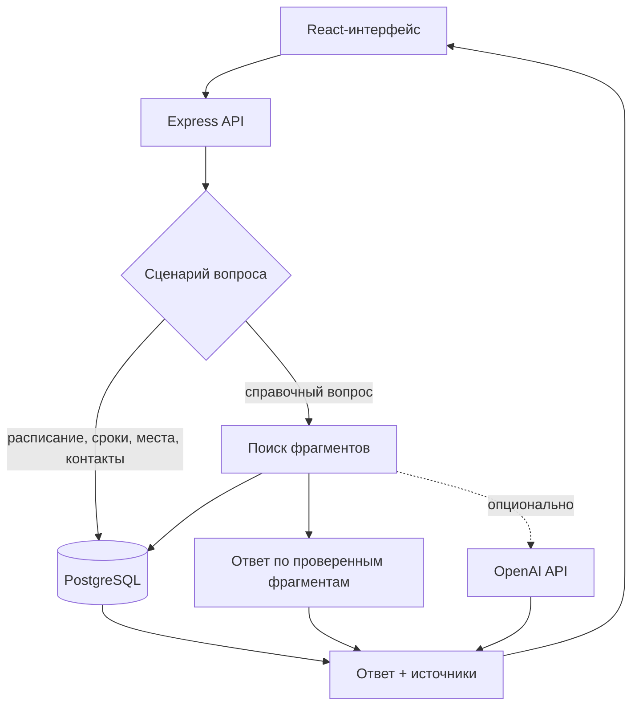

# Требования и архитектура MVP

## 1. Проблема

Первокурсник получает информацию из разных каналов: расписания, учебных систем, сайтов подразделений, сообщений преподавателей и локальных инструкций. Пользователю сложно понять, где искать актуальный ответ и какое действие выполнить дальше.

MVP проверяет одну гипотезу: единая точка входа с указанием источника сокращает время на типовые учебные и организационные задачи и уменьшает число ошибочных обращений.

## 2. Пользователи и стейкхолдеры

| Роль | Потребность | Польза MVP |
|---|---|---|
| Первокурсник | быстро понять, что, где и когда делать | ответ по своей группе и следующий шаг |
| Учебный офис | уменьшить повторяющиеся вопросы | студент получает инструкцию до обращения |
| Владелец документа | контролировать актуальность | ответ содержит источник и дату проверки |
| Команда проекта | доказать ценность решения | измеримые сценарии, отзывы и журнал ошибок |

## 3. Основные сценарии

1. Узнать занятия на сегодня или завтра.
2. Увидеть ближайшие дедлайны.
3. Найти корпус, аудиторию или офис.
4. Понять, в какое подразделение обратиться.
5. Получить ответ по проверенной инструкции с видимым источником.
6. Сообщить, помог ли ответ.

## 4. Границы

В MVP входят поиск и объяснение. Изменение расписания, отправка заявления, запись на приём и другие действия с последствиями не выполняются автоматически. Ассистент может подготовить следующий шаг, но пользователь должен явно подтвердить внешнее действие в будущей версии.

Не входят: персональные оценки, медицинские данные, финансовые операции, автоматическая авторизация в университетских системах и ответы без подтверждённой базы знаний.

## 5. Архитектура

Для структурированных данных модель не вызывается. Это делает время, аудиторию и срок воспроизводимыми. Базовый режим также отвечает на справочные вопросы без внешней модели, показывая найденные проверенные фрагменты. Если включён режим `openai`, модель получает только эти фрагменты и системную инструкцию не использовать внешние знания. При сбое провайдера приложение возвращается к детерминированному ответу.

## 6. Модель данных

| Сущность | Назначение | Возможность расширения |
|---|---|---|
| `study_groups` | учебная группа и программа | дополнительные атрибуты в `metadata` |
| `schedule_entries` | занятие на дату и время | внешний ключ интеграции в `external_key` |
| `deadlines` | срок для группы или всех групп | статус, описание, источник |
| `campus_locations` | корпус, аудитория, офис | карта, ориентир, произвольные метаданные |
| `departments` | подразделение и контакты | связь с местом и источником |
| `knowledge_sources` | документ и его статус | владелец, URL, дата проверки |
| `knowledge_chunks` | поисковые фрагменты документа | теги и полнотекстовый индекс |
| `feedback` | полезность ответа | сценарий и наличие источника |

Новые предметные таблицы можно добавлять отдельными миграциями. `JSONB metadata` предусмотрен для редких полей, но основные фильтруемые значения должны оставаться обычными столбцами.

## 7. Контроль источников

Жизненный цикл документа:

1. Владелец предоставляет официальный файл или ссылку.
2. Команда удаляет устаревшие версии и персональные данные.
3. Документ импортируется со статусом `draft`.
4. Ответственный сотрудник проверяет текст и дату действия.
5. Документ повторно импортируется с `--verified`.
6. При замене источник обновляется с тем же `source_key`.
7. Устаревший источник получает статус `archived` и перестаёт участвовать в поиске.

Не следует загружать модели документы целиком при каждом запросе. Помимо цены и задержки это ухудшает управляемость контекста и усложняет проверку, на каком основании сформирован ответ.

## 8. Интеграции

| Интеграция | MVP | Следующий этап |
|---|---|---|
| OpenAI | отключён по умолчанию; Responses API включается настройкой backend | оценка добавочной пользы модели на тестовом наборе |
| PostgreSQL | основное хранилище и русский FTS | при необходимости `pgvector` и гибридный поиск |
| Расписание | начальная загрузка в таблицу | синхронизация с официальным API/выгрузкой |
| Дедлайны | ручная или пакетная загрузка | LMS-интеграция после согласования доступа |
| Карта | адрес и текстовый ориентир | официальный картографический слой |
| Авторизация | отсутствует | SSO и привязка группы с минимальными правами |

## 9. Безопасность и приватность

- строка подключения к БД и опциональный ключ OpenAI доступны только backend;
- CORS разрешает только перечисленные frontend-адреса;
- тело запроса ограничено 64 КБ, API имеет ограничение частоты;
- модель не вызывается, если поиск не нашёл проверенный источник или выбран режим `verified-data`;
- инструкции внутри документов трактуются как данные, а не команды;
- в MVP история чата остаётся в `localStorage` и не записывается на сервер;
- в начальном наборе официальных данных нет персональных данных студентов;
- перед пилотом нужен срок хранения обратной связи и ответственный за удаление.

## 10. Критерии готовности

- все пять основных вопросов можно пройти с мобильного и настольного экрана;
- ответ по расписанию и дедлайну совпадает с записью БД;
- каждый фактический справочный ответ содержит хотя бы один видимый источник;
- при отсутствии источника система честно сообщает, что ответ не найден;
- ошибочный ключ модели не блокирует ответы по официальным данным; недоступная БД и пустые данные показаны понятным состоянием;
- production-сборка, линтер и backend-тесты проходят;
- у каждого фактического ответа видны официальный источник и дата проверки.

## 11. Решение о векторном поиске

На первой версии используется встроенный полнотекстовый поиск PostgreSQL. Он проще для развёртывания, не требует отдельной модели эмбеддингов и даёт понятную исходную метрику. `pgvector` оправдан, если на реальном контрольном наборе доля вопросов с подходящим фрагментом в первых пяти результатах окажется ниже целевого уровня. До этого добавление векторной инфраструктуры создаст сложность без подтверждённой пользы.
